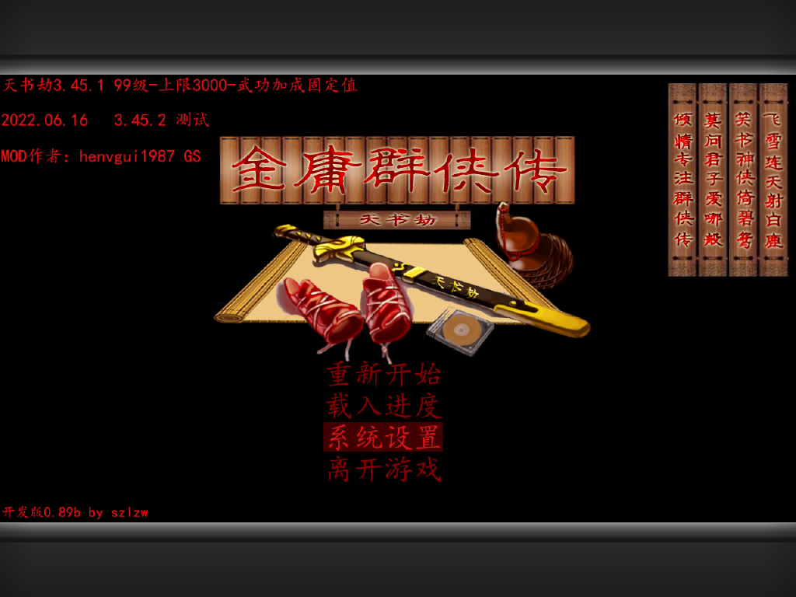
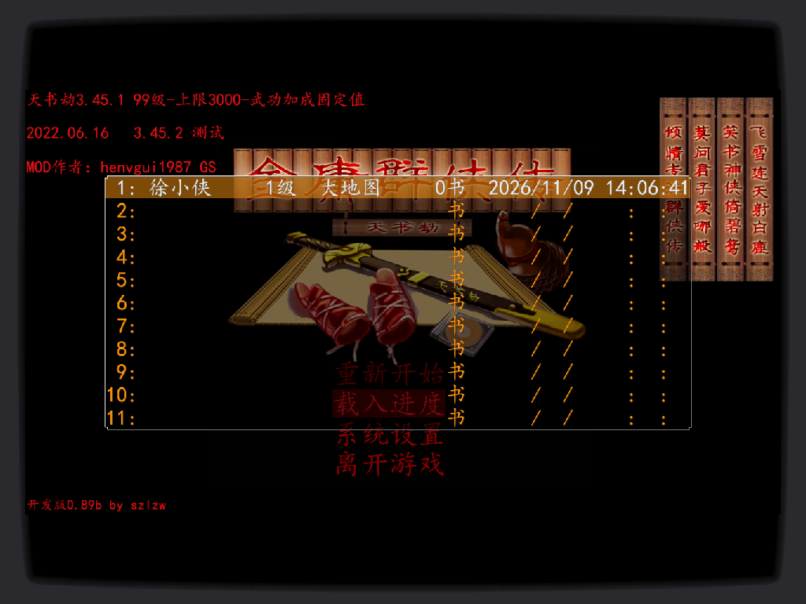
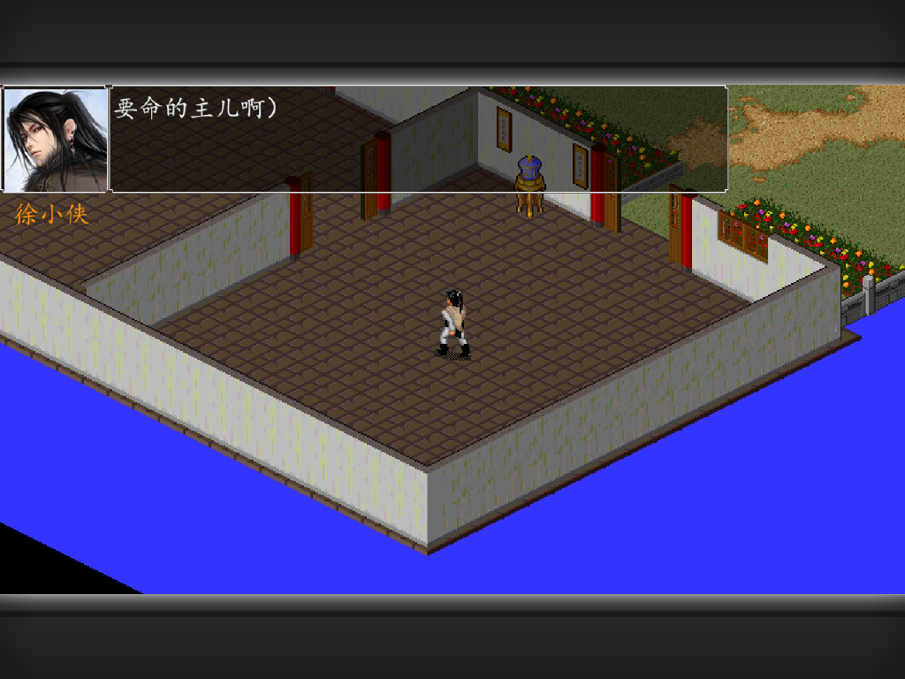
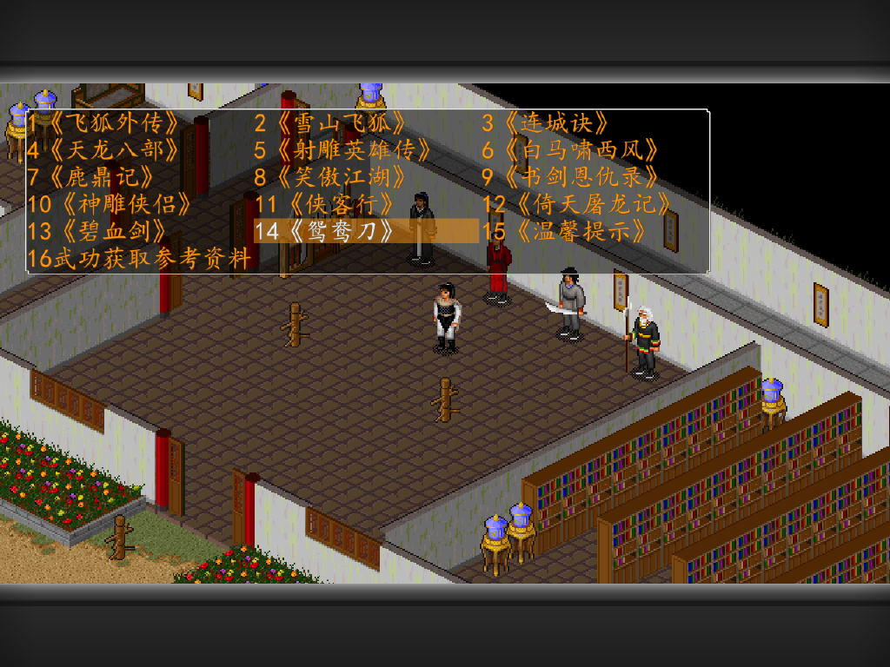
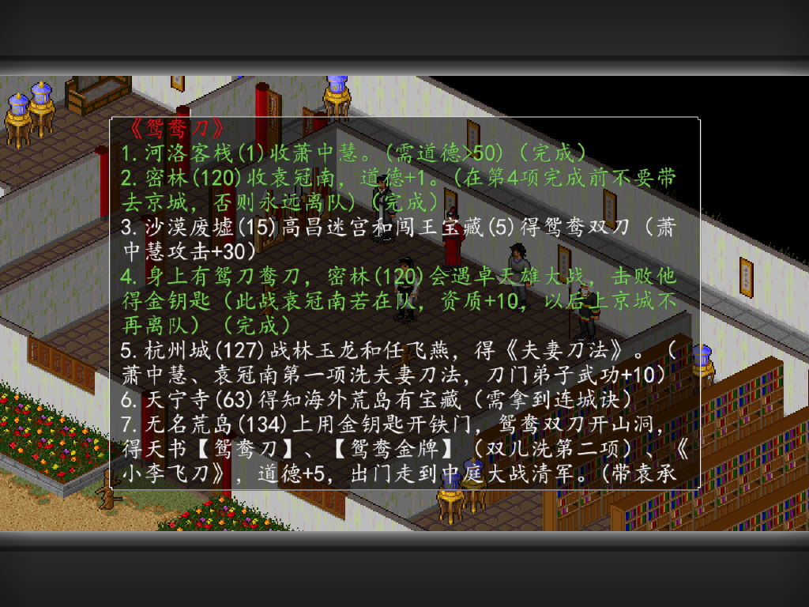
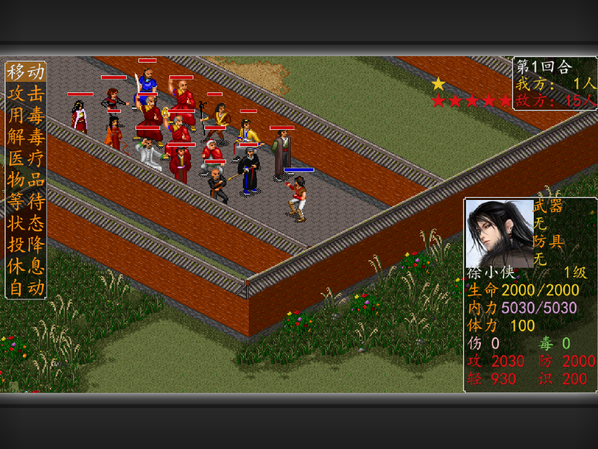

# 金庸群侠传 MOD《天书劫 原味强化版 4.0》· TrimUI Brick 移植项目

本项目将《天书劫 4.0 原味强化版》从 Windows 平台迁移至 TrimUI Brick 掌机（Allwinner A133 / 1024×768 / glibc 2.33 / FAT32）。
移植目标：保持游戏数据原样、功能完整——剧情、战斗、BGM、音效、立绘、存档、系统菜单、内置攻略及剧情变色均可用。

**当前版本：v1.0.0（2026-11-10）**

---

## 一、功能状态

| 功能模块 | 状态 | 说明 |
|---|---|---|
| 剧情 / 战斗 / 大地图 / 存档 / 系统菜单 / 手柄 / 中文显示 | ✅ | 数据原样，全流程功能不裁减 |
| 内置攻略（16 本）/ 剧情完成变色标记 | ✅ | 系统 → 系统攻略；已完成条目整行变绿并标「（完成）」 |
| BGM 与音效（含战斗特效音效） | ✅ | 已修复并真机验证 |
| 人物立绘（含 MOD 新增人物） | ✅ | 固定框 146：大图缩、小图放大 |
| 画面输出 | ✅ | 1024×576 满宽 + 上下机框遮罩，不变形、不裁边 |
| 过场 MPEG 动画 | ⚠️ | 直写模式下跳过，不影响剧情推进 |
| 文字放大 | ❌ | 会撑破 4.0 固定框排版，经评估后放弃 |

截图见 [`screenshots/`](screenshots/)。

| 标题界面 | 载入进度（1280 排版完整） |
|---|---|
|  |  |

| 立绘固定框 146 | 内置攻略 16 本 |
|---|---|
|  |  |

| 已完成剧情变绿 +「（完成）」 | 战斗界面 |
|---|---|
|  |  |

---

## 二、来源与归属

### 2.1 游戏与数据（本仓库不包含）

| 对象 | 来源 | 说明 |
|---|---|---|
| 《金庸群侠传》原作 | 河洛工作室 | 1996 年原作，剧情与系统源头 |
| 《天书劫》MOD | **szlzw** | 4.0 原味强化版剧情、脚本、界面、攻略体系；数据版本 V18.0 |
| 游戏数据 / 素材 / 字体 / 音乐 | 随 4.0 发布包提供 | 需自行准备，本仓库不含 |

### 2.2 引擎与依赖库

| 组件 | 来源 | 用途 |
|---|---|---|
| jysdl-bh 引擎（SDL2 分支 `sdl2-surface`） | 开源项目 **scarsty**，commit `5d5ba9a` | 游戏主程序；本项目在其基础上打补丁 |
| SDL2 2.30 | 设备固件自带 `/usr/trimui/lib` | 窗口 / 事件 / 输入 / 音频抽象 |
| BASS + BASSMIDI | **Un4seen Developments** | MIDI 与音效解码 |
| gptokeyb | PortMaster 生态 | 手柄事件转键盘输入 |
| zig 0.13.0 | 自带 clang/LLD，target `aarch64-linux-gnu.2.33` | 交叉编译 aarch64 二进制 |
| 机框遮罩素材 | `bars-wsc.png` 取自开源模拟器素材；`bars-crt*.png` 自绘 | 遮盖上下黑边 |

### 2.3 本项目自写部分（MIT）

- 引擎侧补丁：`/dev/fb0` 直写后端、`JY_FixAudioPath`、立绘固定框、`JY_KEYLOG`；
- 工具链：`jyinject`、`raw2png`、`head_fix`、`png_hole`、`make_bars*`、`elf_needed`；
- 启动与配置：`launch.sh`、`jysdllua.gptk`、`fix-help-case.sh`。

---

## 三、关键问题与解决方案

| 问题 | 解决方案 |
|---|---|
| 复制 SDL1.2 库后启动崩溃（`rc=139`） | 经 ABI 比对确认代差不兼容，放弃补库方案，改为自写 `/dev/fb0` 直写后端 |
| 二级界面文字被裁切、右侧书册消失 | 内部渲染面必须等于 4.0 原生排版 1280×720，缩放仅置于输出阶段 |
| 缩放后中文笔画断裂 | 最近邻采样改为盒式平均（面积平均） |
| 上下黑边 | 0.8 为 1024×768 上唯一满宽不裁边比例，预合成机框遮罩 |
| 按键无响应 | 引擎仅监听键盘事件；采用 gptokeyb + `/dev/uinput` 合成键盘事件 |
| BGM 无声（`code=41`） | `BASS_StreamCreateFile` 不支持 MIDI，改用 `BASS_MIDI_StreamCreateFile` |
| 路径正确仍无法打开音频 | FAT32 大小写敏感；`JY_FixAudioPath()` 逐扩展名重试并做大小写不敏感比较 |
| MIDI 有流但静音 | `set.ini` 中 `MP3=0`，音量调整至 50/40 |
| 原版人物立绘过小 | 引擎丢失 `zoom` 参数；改为固定框 146，按最长边缩放 |
| 内置攻略点击后静默退回 | 引擎读取 `data/Help/`，卡上为 `data/help`；按精确大小写重建目录 |
| 直写后主页覆盖游戏画面 | `launch.sh` 中 `kill -STOP` 挂起 MainUI，退出时恢复 |
| 特效音效异常 | 已修复：统一音频路径解析，BASS MIDI 与音效通道分离，真机验证战斗技能音效正常 |

**三条核心判断：**

1. 优先比对 `DT_NEEDED` 与后端字符串，再决定是否自行实现后端；
2. 引擎原生画布不得小于其排版宽度，缩放仅置于输出阶段；
3. "点击无反应"多为资源路径大小写问题，老引擎往往静默失败。

完整过程见 [`docs/01~13`](docs/)。

---

## 四、快速开始

目标目录：`/mnt/SDCARD/Ports/jysdlbh/`

```sh
# 1) 将「天书劫原味强化版4.0 正式发布版(V18.0)」解压至该目录（应包含 data/ script/ set.ini）
# 2) 将 release/ 内容覆盖至同一目录（jysdllua、launch.sh、config.json、icon.png、gptokeyb、jysdllua.gptk、overlays/）
# 3) 修正攻略目录大小写
cd /mnt/SDCARD/Ports/jysdlbh && sh fix-help-case.sh
# 4) FAT32 无 Unix 权限位，统一放开权限
chmod -R 777 /mnt/SDCARD/Ports/jysdlbh
```

从掌机 **Ports 菜单**进入。请勿从 SSH 直接运行——MainUI 会重绘 `/dev/fb0` 覆盖画面；`launch.sh` 已负责游戏期间挂起、退出恢复。

---

## 五、设备参数

| 项目 | 实测值 |
|---|---|
| SoC / CPU | Allwinner A133（sun50iw10），4×Cortex-A53，64 位 |
| 内存 | 975 MB 可用，无 swap |
| 屏幕 | 1024×768，`/dev/fb0` 32bpp，`line_length=4096` |
| 系统 | Tina Linux（BusyBox），内核 4.9.191，glibc 2.33 |
| 存储 | TF 卡 238 GB，FAT32，`codepage=437,iocharset=utf8` |
| 关键特性 | FAT32 按大小写敏感解析文件名 |
| 设备编译能力 | 不可用（无 gcc/make/python3/lua/git/ldd，`/rom` 只读） |

---

## 六、仓库结构

```
docs/        移植过程与经验（01~13）
tools/       自写诊断/转换/注入工具
patches/     引擎侧补丁脚本（PowerShell，幂等）
release/     移植层（jysdllua、launch.sh、config.json、gptokeyb、overlays/、fix-help-case.sh）
screenshots/ 真机抓帧
```

---

## 七、复用至其他版本

同一引擎家族（jysdl-bh / SDL2 分支）的其他作品可直接套用本流程：先读取 `set.ini` 的 `Width/Height` 确定内部渲染面；先跑通默认 EGL 路径再启用 `JY_FBDEV=1`；输入优先走 gptokeyb；资源按精确大小写准备；立绘采用固定框。详见 [`docs/12`](docs/12-移植其他版本-清单.md)。

---

## 八、已知问题

1. 过场 MPEG 在直写模式下跳过；
2. 遮罩内沿与画面最上沿约 3 px 细缝；
3. 0.8 为不裁边最大等比，更大比例只能裁边或拉伸；
4. 直写单缓冲、无 vsync，快速横移可能出现撕裂；
5. 文字放大未实现（会撑破对话框边框）。

---

## 九、许可与声明

本仓库不包含任何游戏本体数据、字体、音乐素材。《天书劫》版权归 **szlzw**，《金庸群侠传》归 **河洛工作室** 及相关权利方。引擎 jysdl-bh（scarsty）遵循其上游许可；BASS/BASSMIDI 版权归 Un4seen Developments。本项目自写工具与文档采用 MIT 许可。个人移植研究，请勿用于商业分发。
